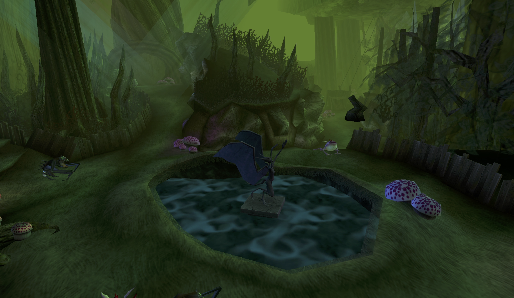

# MediEvil: Resurrection Toolkit & PC Port

Real-time 3D level and model viewer, archive extraction toolkit, and reverse engineering workspace for **MediEvil: Resurrection** (Sony PSP, Studio Cambridge, 2005 - UCES00052).

Opens the native PSP archive (`USRDIR/gamedata.bin`), decodes geometry and textures directly from disc data, and renders full levels and individual meshes using OpenGL 4.1.



## Features

- **Direct Archive Streaming:** Reads levels, models, and textures directly from `gamedata.bin` via binary search tree lookup without unpacking.
- **Geometry Decoding:** Parses `FRG0` geometry fragments inside `MOD0` (props, characters) and `SBZ0` (level subzones), converting PSP triangle strips and variable vertex formats (vtype 0x1BE / 0x1A2) to modern vertex buffers.
- **PSP Texture Decoding:** Decodes native `PSM0` textures, including CLUT4 (4-bit indexed), CLUT8 (8-bit indexed), and RGBA5551 formats with automatic 16x8 swizzle deswizzling.
- **Interactive 3D Viewer:** Built with SDL2, OpenGL 4.1 Core, and Dear ImGui. Supports free-cam navigation, texture toggles, vertex colors, wireframe mode, and level group filtering.
- **Headless Screenshot Render:** Render any level or model offscreen directly to PNG without opening a window (`--shot`).
- **Reverse Engineering Pipeline:** Python tools for ISO9660 extraction, archive unpacking, hash-based symbol name recovery, and headless Ghidra batch decompilation.

## Requirements

- **C++17 compiler** (Clang, GCC, or MSVC)
- **CMake** 3.16+
- **OpenGL 4.1+**
- **GLEW**
- **SDL2**
- **Python 3.8+** (for tools and extraction scripts)

Dependencies fetched automatically via CMake FetchContent:
- [Dear ImGui](https://github.com/ocornut/imgui) (v1.91.8)
- [GLM](https://github.com/g-truc/glm) (1.0.1)

### Installing Dependencies

**macOS (Homebrew):**
```bash
brew install cmake ninja sdl2 glew
```

**Ubuntu / Debian:**
```bash
sudo apt-get install cmake ninja-build libsdl2-dev libglew-dev libgl1-mesa-dev
```

## Building

```bash
cmake -S . -B build -G Ninja
cmake --build build
```

Build artifacts:
- `build/medievil-viewer` - interactive viewer executable
- `build/libmedievil-core.a` - static library containing archive, chunk, texture, and geometry parsers (no OpenGL or SDL dependency)

## Quick Start

### 1. Extract the Game Files

Extract the PSP UMD ISO to the `extracted/` directory:

```bash
python3 -I tools/iso_extract.py "path/to/MediEvil - Resurrection.iso" extracted
```

Verify that `extracted/PSP_GAME/USRDIR/gamedata.bin` exists.

### 2. Run the Viewer

Launch the interactive viewer:

```bash
./build/medievil-viewer
```

By default, the viewer loads `extracted/PSP_GAME/USRDIR/gamedata.bin` and resolves asset names using `docs/names.tsv`.

### CLI Options

```bash
# Load specific level group on startup (e.g. group 2 - Graveyard)
./build/medievil-viewer --group 2

# Inspect a specific 3D model
./build/medievil-viewer --model all_switch.mesh

# Custom paths for gamedata and symbol dictionary
./build/medievil-viewer --data path/to/gamedata.bin --names path/to/names.tsv

# Headless render to PNG (no window opened)
./build/medievil-viewer --group 2 --shot graveyard.png --yaw -90 --pitch -35
./build/medievil-viewer --model all_coffin_floating.mesh --shot coffin.png
```

### Viewer Controls

| Input | Action |
|---|---|
| **1-Finger Trackpad Click & Drag** (or LMB / RMB) | Look around / rotate camera (smooth relative mode, no screen border limits) |
| **W / A / S / D** | Move forward / left / backward / right |
| **Q / E** (or **Space / C**) | Move down / up |
| **Shift / Ctrl** | Speed multiplier: Shift = 4x turbo boost, Ctrl = 0.25x precision |
| **Shift + Drag** | Pan camera along screen plane |
| **2-Finger Trackpad Scroll** (or Wheel) | Dolly zoom in / out |
| **F key** (or Frame button) | Focus / frame active level or model |

## Tools & Pipeline

All helper scripts are located in `tools/`:

- `tools/iso_extract.py` - Minimal ISO9660 extractor for PSP UMD images.
- `tools/gamedata_extract.py` - Batch unpacker for `gamedata.bin` archives.
- `tools/namehash.py` - Recovers hashed asset names from `main.prx` string tables using analytical suffix stripping on the hash129 algorithm.
- `tools/psm2png.py` - Standalone PSP `PSM0` texture converter to PNG.
- `tools/chunkdump.py` - Inspects hierarchical FourCC chunk trees.
- `tools/ghidra_scripts/` - Headless Ghidra scripts for automated analysis, table export, and function decompilation.

## Repository Layout

```
.
├── CMakeLists.txt        # Build definition for medievil-core and medievil-viewer
├── src/
│   ├── Core/             # Headless library: GameData, Texture, Geometry parsers
│   └── Viewer/           # SDL2 + OpenGL 4.1 renderer and Dear ImGui frontend
├── tools/                # Extraction, conversion, and Ghidra analysis scripts
├── docs/
│   ├── RE_NOTES.md       # Detailed reverse engineering notes and format specs
│   ├── names.tsv         # Hash-to-filename dictionary (1200+ recovered names)
│   ├── iso_filelist.txt  # File list from retail UMD
│   └── ghidra/           # Exported function, import, string, and FourCC tables
└── decomp/               # Decompiled C listings and index
```

## Documentation

For technical details on executable structure (`main.prx`), archive headers, FourCC chunk formats, and port strategy, see [docs/RE_NOTES.md](docs/RE_NOTES.md).

## Legal / Disclaimer

MediEvil and MediEvil: Resurrection are registered trademarks of Sony Interactive Entertainment / SCE Studio Cambridge.
This repository is an independent reverse engineering and software preservation project.
It contains no copyrighted game binaries, media streams, textures, audio banks, or proprietary Sony code.
To build and run the viewer or use the extraction tools, users must provide their own legally acquired copy of the game.

## License

This project is licensed under the MIT License - see the [LICENSE](LICENSE) file for details.
